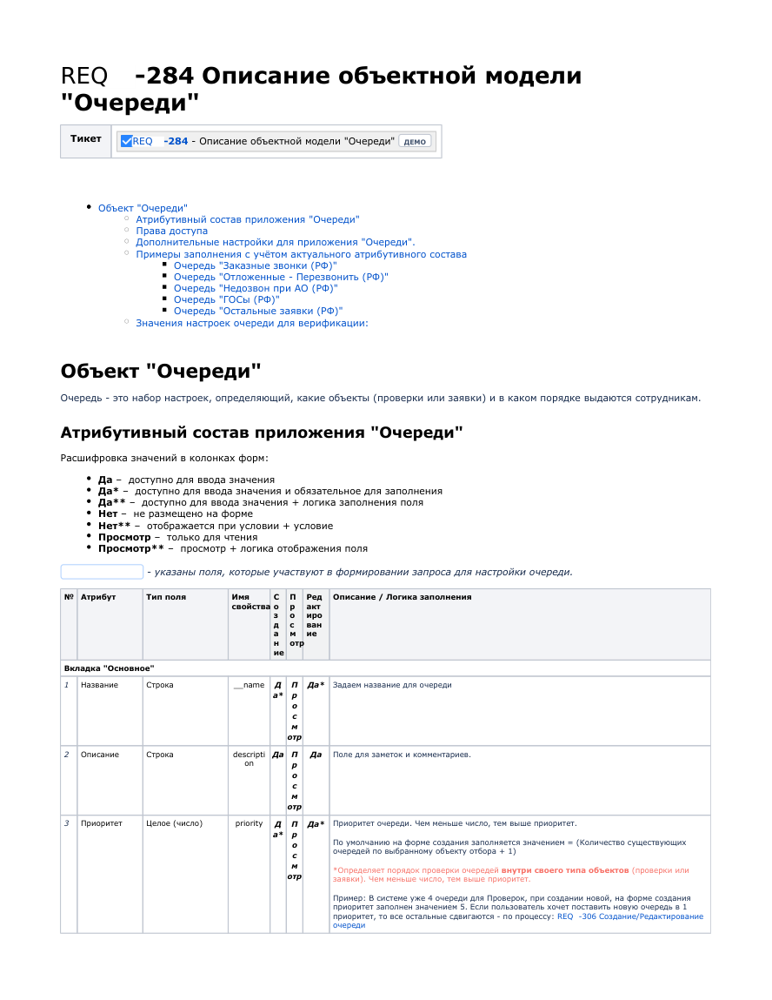

# Объектная модель очередей

Атрибутивный состав очереди, доступность полей на формах, правила географической фильтрации, матрица прав и примеры заполнения.

[Открыть полный PDF](document.pdf) · 6 страниц · [Все примеры](../../README.md)

## Содержание

- Модель данных и правила заполнения
- Доступ по ролям
- Примеры конфигурации очередей

## Превью

