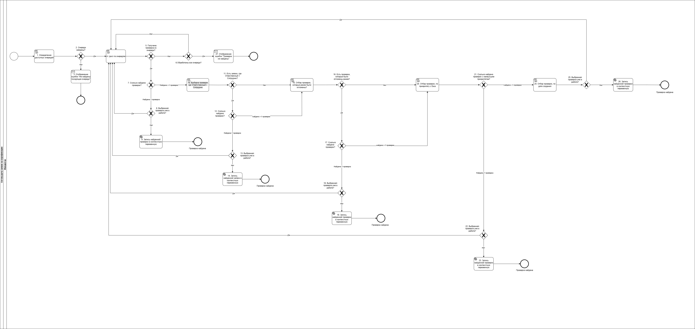

# Автовыдача проверки

Полное текстовое описание процесса из постановки: **27 шагов**, все ветвления, цикл по очередям, географические фильтры, критерии отбора, повторные попытки и ошибки.

[Все примеры](../../README.md) · [PDF полного документа](document.pdf) · [Схема в полном размере](process-diagram.png)

## Назначение и запуск

Модуль «Автовыдача проверок» ищет для сотрудника антифрода наиболее приоритетную проверку из доступных очередей. Запускается родительским процессом REQ-89 «Автоматическое назначение проверки из очереди».

Модуль выполняет поиск и выбор. Назначение, перевод статуса и последующую обработку найденной проверки выполняет родительский процесс.

## Участники и параметры

| Параметр | Описание |
| --- | --- |
| Зона ответственности | Система автоматически выполняет поиск и выбор проверки |
| Вход Сотрудник | Текущий сотрудник, которому нужно выдать проверку |
| Выход Проверка | Найденный элемент приложения Проверки |
| Выход Текст ошибки | Ошибка поиска или выполнения процесса |

## Географическая фильтрация

Основной гео-атрибут — `[Очередь.Сайт регистрации]`. Если он заполнен, используется соответствие сайту регистрации контрагента проверки.

Вспомогательный атрибут — `[Очередь.Страна контрагента]`. Он используется для уточнения маршрута, когда сайта регистрации недостаточно. Если поле не заполнено, фильтр по нему не применяется.

Страна продаж сотрудника отдельно не проверяется. Доступ сотрудника к очереди определяется его ролью, а география отбираемых проверок — настройками очереди.

## Последовательность критериев

| Приоритет | Критерий | Шаги |
| --- | --- | --- |
| 1 высший | Ответственный равен текущему сотруднику | 10–14 |
| 2 | Проверка была ранее отложена | 15–19 |
| 3 | Максимальный приоритет бэкенда | 20–23 |
| 4 низший | Самая ранняя дата создания | 24–26 |

Каждый последующий критерий применяется к набору, оставшемуся после предыдущего. Если по критерию нет кандидатов, сохраняется предыдущий набор. Приоритет очереди и приоритет бэкенда различаются: у очереди меньше число означает более высокий приоритет, у проверки — больше число.

## Навигация по всем шагам

- [Шаг 1 — Определение доступных очередей](#step-1)
- [Шаг 2 — Настройки очереди найдены?](#step-2)
- [Шаг 3 — Не найдены подходящие очереди](#step-3)
- [Шаг 4 — Цикл по очередям](#step-4)
- [Шаг 5 — Получена проверка из очереди?](#step-5)
- [Шаг 6 — Обработаны все очереди?](#step-6)
- [Шаг 7 — Сколько найдено проверок?](#step-7)
- [Шаг 8 — Выбранная проверка уже в работе?](#step-8)
- [Шаг 9 — Запись найденной проверки в контекстную переменную](#step-9)
- [Шаг 10 — Выборка проверок где Ответственный равен Сотруднику](#step-10)
- [Шаг 11 — Есть проверки назначенные сотруднику?](#step-11)
- [Шаг 12 — Сколько найдено проверок сотрудника?](#step-12)
- [Шаг 13 — Выбранная проверка уже в работе?](#step-13)
- [Шаг 14 — Запись найденной проверки в контекстную переменную](#step-14)
- [Шаг 15 — Отбор проверок которые были ранее отложены](#step-15)
- [Шаг 16 — Есть ранее отложенные проверки?](#step-16)
- [Шаг 17 — Сколько найдено ранее отложенных проверок?](#step-17)
- [Шаг 18 — Выбранная проверка уже в работе?](#step-18)
- [Шаг 19 — Запись найденной проверки в контекстную переменную](#step-19)
- [Шаг 20 — Отбор проверок по приоритету бэкенда](#step-20)
- [Шаг 21 — Сколько проверок с наивысшим приоритетом?](#step-21)
- [Шаг 22 — Выбранная проверка уже в работе?](#step-22)
- [Шаг 23 — Запись найденной проверки в контекстную переменную](#step-23)
- [Шаг 24 — Отбор проверки с самой ранней датой создания](#step-24)
- [Шаг 25 — Выбранная проверка уже в работе?](#step-25)
- [Шаг 26 — Запись найденной проверки в контекстную переменную](#step-26)
- [Шаг 27 — Проверки не найдены](#step-27)

## Полная схема процесса

## Шаг 1 Определение доступных очередей

Система ищет элементы приложения «Очереди», удовлетворяющие всем условиям:

| Условие | Описание |
| --- | --- |
| Объект для отбора = Проверка | Учитываются только очереди проверок |
| Роли очереди содержат хотя бы одну роль сотрудника | Доступ определяется ролью сотрудника |
| Активно = Да | Очередь включена |
| Дни недели содержат текущий день или не заполнены | Учитываются дни активности очереди |

Найденные очереди сортируются по полю «Приоритет»: меньше число — выше приоритет. Переход на шаг 2.

## Шаг 2 Настройки очереди найдены?

| Ветка | Условие | Переход |
| --- | --- | --- |
| Да | Найдена хотя бы одна подходящая очередь | Шаг 4 |
| Нет | Для сотрудника очереди не настроены | Шаг 3 |

## Шаг 3 Не найдены подходящие очереди

Система показывает всплывающее сообщение: «Для вас не настроена очередь обработки проверки. Обратитесь к руководителю». Процесс завершается.

## Шаг 4 Цикл по очередям

Система последовательно обрабатывает очереди шага 1 в порядке их приоритета. Цикл продолжается, пока не найдена очередь хотя бы с одной подходящей проверкой либо пока не закончились очереди.

### Ограничение повторного поиска

При возврате на шаг 4 из шагов 8, 13, 18, 22 или 25 счётчик попыток увеличивается на 1. Максимальное число попыток `N` в исходнике обозначено как предварительно **3**. При превышении 3 процесс записывает в выходной параметр «Текст ошибки» сообщение «Превышено максимальное количество попыток поиска свободной проверки» и завершается. Переход к следующей пустой очереди и повторный поиск после конфликта — разные причины возврата; счётчик в исходнике явно задан для возвратов из пяти проверок занятости.

### 4.1 Формирование условий текущей очереди

| Условие | Когда применяется | Логика |
| --- | --- | --- |
| Статус | Всегда | Проверка.Статус = В очереди |
| Сайт регистрации | Если поле очереди заполнено | Проверка.Контрагент.Сайт регистрации = Очередь.Сайт регистрации |
| Страна контрагента | Если поле очереди заполнено | Проверка.Контрагент.Страна = Очередь.Страна контрагента |
| Дополнительные условия | Если поле очереди заполнено | Применяются условия справочника REQ-134 |

Если поле очереди не заполнено, соответствующий фильтр не применяется. Отдельная сущность EQL-запроса не используется: запрос собирается из атрибутов очереди.

### 4.2 Поиск проверок

Система выполняет запрос по сформированным условиям. В текущей реализации из исходного документа получают **первые 50 проверок**, предварительно отсортированных по приоритету бэкенда по убыванию: больше число — выше приоритет.

### 4.3 Результат итерации

| Результат | Действие |
| --- | --- |
| Проверки найдены | Коллекция сохраняется в контексте; переход на шаг 5 |
| Проверки не найдены | Переход на шаг 6 |

## Шаг 5 Получена проверка из очереди?

| Ветка | Действие |
| --- | --- |
| Да | Коллекция найденных проверок передаётся в контекст; переход на шаг 7 |
| Нет | Проверки не найдены; переход на шаг 6 |

## Шаг 6 Обработаны все очереди?

| Ветка | Действие |
| --- | --- |
| Да | Все очереди проверены, проверок нет; переход на шаг 27 |
| Нет | Есть необработанные очереди; переход на шаг 4 |

## Шаг 7 Сколько найдено проверок?

| Количество | Переход |
| --- | --- |
| Ровно 1 | Шаг 8 |
| Больше 1 | Шаг 10 |

## Шаг 8 Выбранная проверка уже в работе?

Система повторно проверяет статус выбранной проверки перед возвратом результата.

| Ветка | Состояние | Переход |
| --- | --- | --- |
| Да | Проверка уже выдана и находится в статусе В работе | Повторный поиск с шага 4; увеличивается счётчик повторов |
| Нет | Проверка всё ещё находится в статусе В очереди | Шаг 9 |

## Шаг 9 Запись найденной проверки в контекстную переменную

Система записывает выбранный элемент приложения «Проверки» в выходной параметр «Проверка». Процесс завершается. Дальнейшие действия выполняет родительский процесс.

## Шаг 10 Выборка проверок где Ответственный равен Сотруднику

Из коллекции шага 4 отбираются проверки, у которых `[Проверка.Ответственный] = [Сотрудник]`. Результат сохраняется в контекст. Переход на шаг 11.

## Шаг 11 Есть проверки назначенные сотруднику?

| Ветка | Условие | Переход |
| --- | --- | --- |
| Да | В выборке шага 10 есть проверки текущего сотрудника | Шаг 12 |
| Нет | Назначенных текущему сотруднику проверок нет | Шаг 15; используется исходный набор шага 4 |

## Шаг 12 Сколько найдено проверок сотрудника?

| Количество | Действие |
| --- | --- |
| Ровно 1 | Дальнейший отбор не нужен; шаг 13 |
| Больше 1 | Далее отбирать ранее отложенные; шаг 15 |

## Шаг 13 Выбранная проверка уже в работе?

Система повторно проверяет статус выбранной проверки перед возвратом результата.

| Ветка | Состояние | Переход |
| --- | --- | --- |
| Да | Проверка уже выдана и находится в статусе В работе | Повторный поиск с шага 4; увеличивается счётчик повторов |
| Нет | Проверка всё ещё находится в статусе В очереди | Шаг 14 |

## Шаг 14 Запись найденной проверки в контекстную переменную

Система записывает выбранный элемент приложения «Проверки» в выходной параметр «Проверка». Процесс завершается. Дальнейшие действия выполняет родительский процесс.

## Шаг 15 Отбор проверок которые были ранее отложены

Система применяет условие `[Проверка.Была отложена?] = Да` к текущему набору.

| Источник набора | Когда используется |
| --- | --- |
| Выборка шага 10 | Если найдены проверки с ответственным равным текущему сотруднику |
| Коллекция шага 4 | Если такие проверки не найдены |

Результат сохраняется в контекст. Переход на шаг 16.

## Шаг 16 Есть ранее отложенные проверки?

| Ветка | Действие |
| --- | --- |
| Да | Найдены ранее отложенные проверки; переход на шаг 17 |
| Нет | Отложенных проверок нет; переход к приоритету бэкенда на шаг 20 |

## Шаг 17 Сколько найдено ранее отложенных проверок?

| Количество | Действие |
| --- | --- |
| Ровно 1 | Дальнейший отбор не нужен; шаг 18 |
| Больше 1 | Далее отбирать по приоритету бэкенда; шаг 20 |

## Шаг 18 Выбранная проверка уже в работе?

Система повторно проверяет статус выбранной проверки перед возвратом результата.

| Ветка | Состояние | Переход |
| --- | --- | --- |
| Да | Проверка уже выдана и находится в статусе В работе | Повторный поиск с шага 4; увеличивается счётчик повторов |
| Нет | Проверка всё ещё находится в статусе В очереди | Шаг 19 |

## Шаг 19 Запись найденной проверки в контекстную переменную

Система записывает выбранный элемент приложения «Проверки» в выходной параметр «Проверка». Процесс завершается. Дальнейшие действия выполняет родительский процесс.

## Шаг 20 Отбор проверок по приоритету бэкенда

Из текущего набора выбираются проверки с максимальным значением приоритета бэкенда.

| Источник | Когда используется |
| --- | --- |
| Шаг 15 | Найдены ранее отложенные проверки |
| Шаг 10 | Отложенные не найдены, но найдены проверки текущего сотрудника |
| Шаг 4 | Проверки с ответственным равным сотруднику не найдены |

Приоритет бэкенда рассматривается по убыванию. Переход на шаг 21.

## Шаг 21 Сколько проверок с наивысшим приоритетом?

| Количество | Действие |
| --- | --- |
| Ровно 1 | Дальнейший отбор не нужен; шаг 22 |
| Больше 1 | Далее отбирать по дате создания; шаг 24 |

В пояснении исходника этого шага стоит ссылка на выборку «шага 15», хотя заголовок и переход из шага 20 говорят об отборе по приоритету. Это расхождение источника отмечено отдельно и не скрыто при переносе.

## Шаг 22 Выбранная проверка уже в работе?

Система повторно проверяет статус выбранной проверки перед возвратом результата.

| Ветка | Состояние | Переход |
| --- | --- | --- |
| Да | Проверка уже выдана и находится в статусе В работе | Повторный поиск с шага 4; увеличивается счётчик повторов |
| Нет | Проверка всё ещё находится в статусе В очереди | Шаг 23 |

## Шаг 23 Запись найденной проверки в контекстную переменную

Система записывает выбранный элемент приложения «Проверки» в выходной параметр «Проверка». Процесс завершается. Дальнейшие действия выполняет родительский процесс.

## Шаг 24 Отбор проверки с самой ранней датой создания

Система выбирает из текущего набора самую старую проверку: дата создания по возрастанию. Если совпадающих проверок несколько, выбирается первая. Результат сохраняется в контекст. Переход на шаг 25.

## Шаг 25 Выбранная проверка уже в работе?

Система повторно проверяет статус выбранной проверки перед возвратом результата.

| Ветка | Состояние | Переход |
| --- | --- | --- |
| Да | Проверка уже выдана и находится в статусе В работе | Повторный поиск с шага 4; увеличивается счётчик повторов |
| Нет | Проверка всё ещё находится в статусе В очереди | Шаг 26 |

## Шаг 26 Запись найденной проверки в контекстную переменную

Система записывает выбранный элемент приложения «Проверки» в выходной параметр «Проверка». Процесс завершается. Дальнейшие действия выполняет родительский процесс.

## Шаг 27 Проверки не найдены

Система показывает всплывающее сообщение: «Для вас не найдено подходящих проверок для обработки». Процесс завершается.

## Ошибки и исключительные ситуации

| Ситуация | Действие |
| --- | --- |
| Очереди для сотрудника не настроены | Записать ошибку и завершить процесс; сообщение шага 3 |
| Некорректные условия текущей очереди | Зафиксировать ошибку, пропустить очередь и продолжить поиск |
| В текущей очереди нет проверок | Перейти к следующей очереди |
| Все очереди обработаны и проверок нет | Сообщение шага 27 |
| Выбранная проверка уже выдана | Повторить поиск с шага 4 |
| Превышено 3 повторные попытки | Завершить процесс с ошибкой превышения попыток |
| Другая обработанная ошибка | Записать в выходной параметр Текст ошибки |

## Особенности исходной постановки

- Значение `N = 3` указано как предварительное. Формулировка прекращения поиска — «счётчик превышает 3».
- Для ограничения выборки указаны первые 50 проверок с сортировкой по приоритету бэкенда. Критерии ответственного, отложенности и даты применяются к полученной коллекции.
- В шаге 21 сохранено замечание о несовпадающей ссылке на предыдущую выборку.
- При равной дате создания в шаге 24 указан выбор первой записи; дополнительный порядок разрешения равенства в источнике не определён.
- Нумерация схемы и текста сохранена. Служебная редакционная пометка с именем согласующего удалена при обезличивании.
