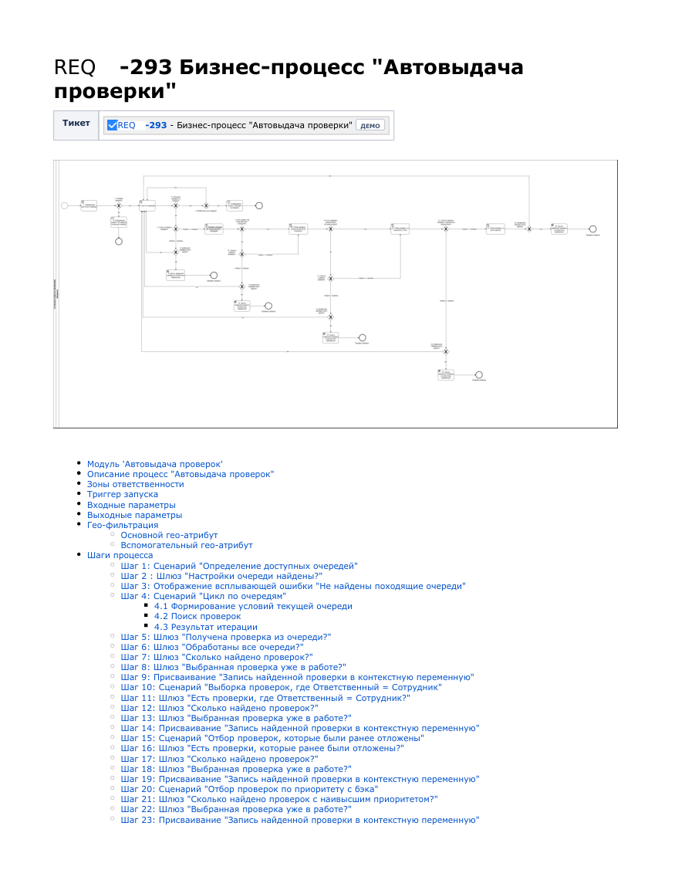

# Бизнес-процесс автовыдачи проверки

Пошаговое описание процесса выбора проверки для сотрудника: доступные очереди, приоритеты, проверка занятости и обработка ошибок.

[Открыть полный PDF](document.pdf) · 9 страниц · [Все примеры](../../README.md)

## Содержание

- Зоны ответственности и параметры процесса
- Условия переходов и последовательность действий
- Приоритеты выдачи и ошибки

## Превью

