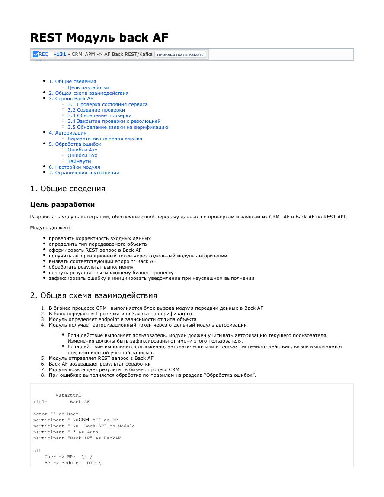

# REST-модуль антифрода

Контракт обмена данными между CRM и сервером антифрода по REST API.

[Открыть полный PDF](document.pdf) · 9 страниц · [Все примеры](../../README.md)

## Содержание

- Проверка состояния сервиса
- Создание, обновление и закрытие проверки
- Обновление заявки на верификацию
- Авторизация, ошибки и тайм-ауты

## Превью

