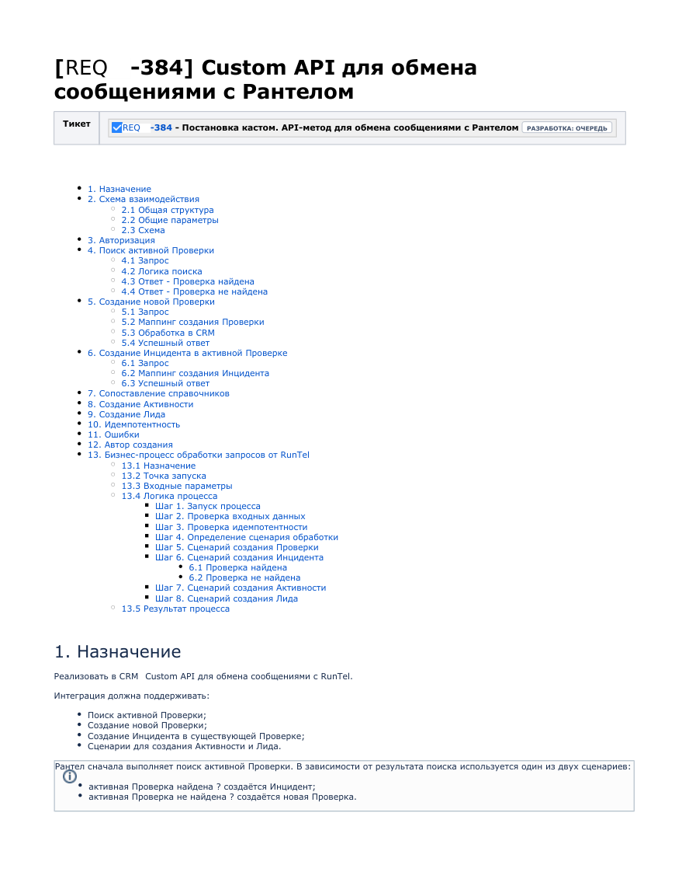

# Custom API для интеграции с телефонией

Описание входящего API на стороне CRM и бизнес-процесса обработки сообщений телефонии.

[Открыть полный PDF](document.pdf) · 11 страниц · [Все примеры](../../README.md)

## Содержание

- Поиск и создание проверок
- Создание инцидента и сопоставление справочников
- Идемпотентность и HTTP-коды ошибок
- Сценарии обработки запросов

## Превью

