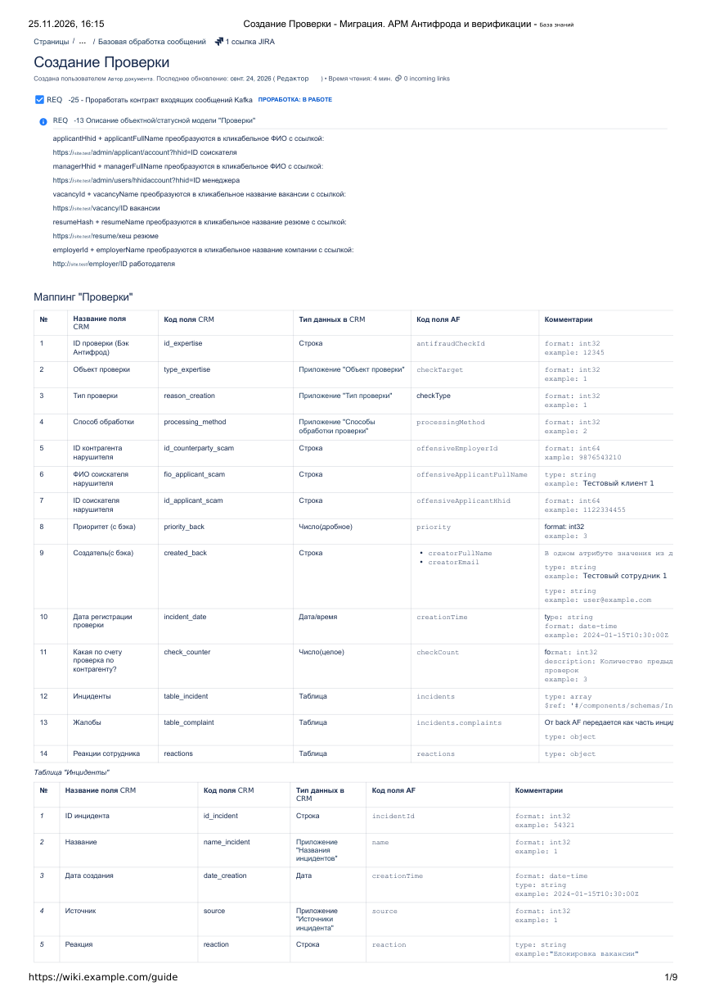

# Создание проверки и маппинг данных

Сопоставление данных серверного антифрода с моделью CRM, пример сообщения Kafka и описание создания элемента через API.

[Открыть полный PDF](document.pdf) · 9 страниц · [Все примеры](../../README.md)

## Содержание

- Маппинг проверки, инцидентов, жалоб и реакций
- Пример сообщения Kafka
- Описание DTO
- Пример запроса на создание записи

## Превью

