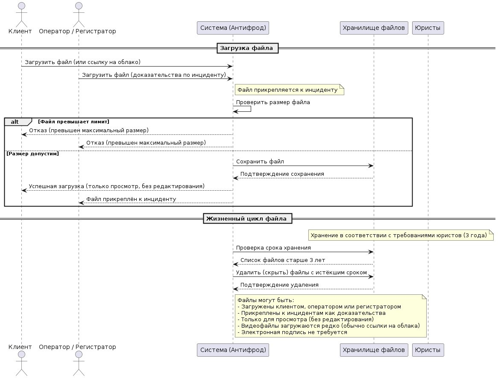

# Загрузка и жизненный цикл файлов

Пример UML-диаграммы последовательности для работы с файлами в системе антифрода. Диаграмма показывает взаимодействие клиента, оператора или регистратора, системы и файлового хранилища.

[Все примеры](../../README.md) · [Открыть изображение в полном размере](file-lifecycle.png)

## Диаграмма

## Сценарий загрузки

1. Клиент или сотрудник передает файл либо ссылку на облачное хранилище как доказательство по инциденту.
2. Система проверяет размер файла.
3. Если размер превышает лимит, система возвращает отказ.
4. Если размер допустим, система сохраняет файл и получает подтверждение хранилища.
5. Пользователь получает подтверждение загрузки и прикрепления файла к инциденту. Для файла предусмотрен просмотр без редактирования.

## Срок хранения

В данном примере срок хранения составляет **3 года** и определяется требованиями юридической службы. Система проверяет срок хранения, получает список файлов старше установленного срока и направляет запрос на удаление или скрытие.

На исходной диаграмме действие обозначено как «Удалить (скрыть)». Выбор конкретного способа обработки требует отдельного уточнения.

## Дополнительные условия

- Файлы прикрепляются к инцидентам как доказательства.
- Загрузку выполняет клиент, оператор или регистратор.
- Видеофайлы загружаются редко; обычно передаются ссылки на облачное хранилище.
- Электронная подпись не требуется.

Срок хранения и ограничения приведены для этого сценария и не задают общие правила для других систем.
