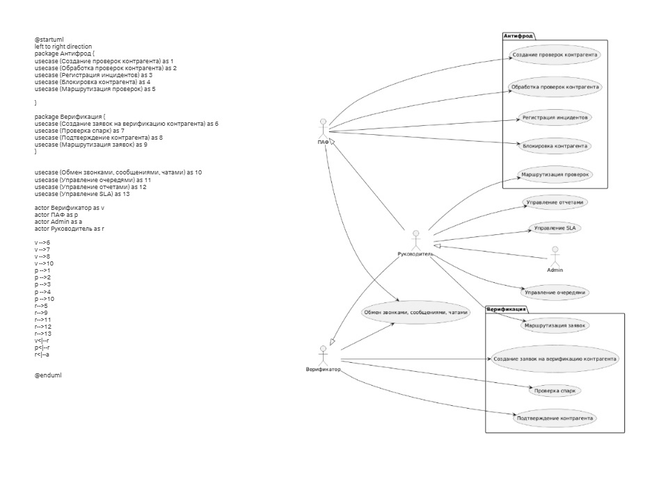

# Роли и варианты использования антифрода и верификации

UML Use Case диаграмма показывает функциональные области системы и взаимодействие ролей с ними.

[Все примеры](../../README.md) · [Открыть изображение](use-cases.png)

## Роли и сценарии

| Роль | Варианты использования на диаграмме |
| --- | --- |
| Специалист антифрода ПАФ | Создание и обработка проверок, регистрация инцидентов, блокировка контрагента, обмен звонками и сообщениями |
| Верификатор | Создание заявок на верификацию, проверка сведений, подтверждение контрагента, обмен звонками и сообщениями |
| Руководитель | Маршрутизация проверок и заявок, управление очередями, отчётами и SLA |
| Администратор | Управление очередями |

Диаграмма описывает связи акторов с функциями. Она не заменяет детальную матрицу прав по статусам объектов и условиям доступа.
