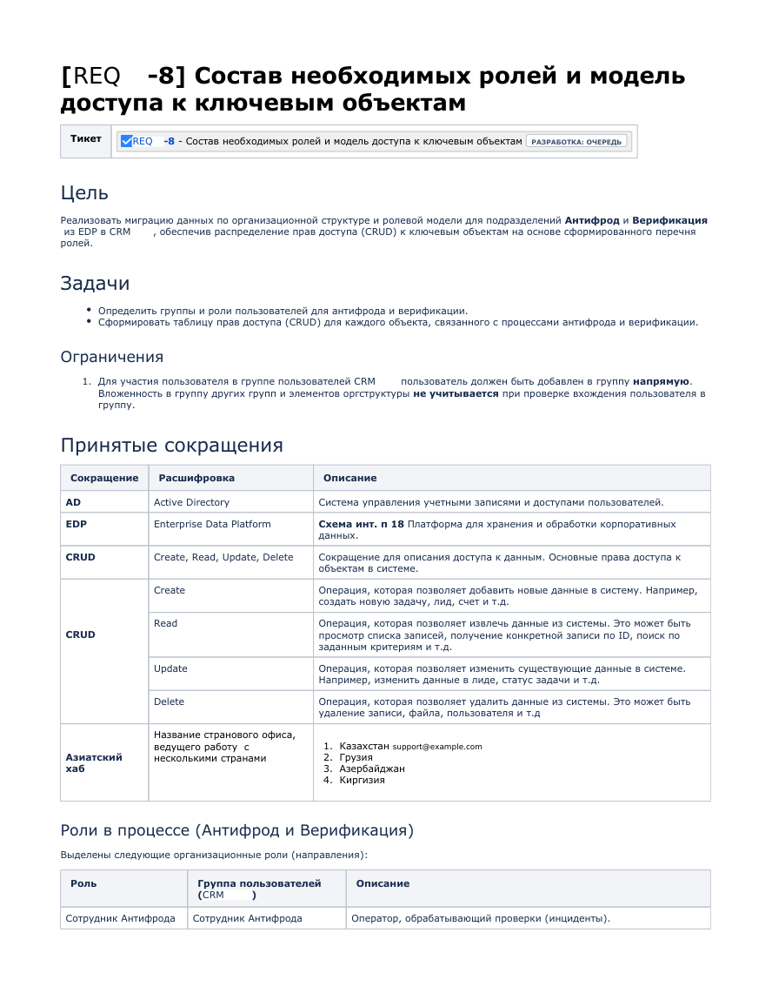

# Роли и модель доступа антифрода и верификации

Обезличенный пример постановки на миграцию организационной и ролевой модели в CRM. Документ определяет группы пользователей, права CRUD и ограничения доступа по стране и назначенному исполнителю.

[Открыть PDF](document.pdf) · 5 страниц · [Все примеры](../../README.md) · [Связанная Use Case диаграмма](../10-antifraud-use-cases/)

## Организационные роли

| Роль | Назначение |
| --- | --- |
| Сотрудник антифрода | Обработка проверок и инцидентов |
| Старший сотрудник антифрода | Отдельная роль в матрице доступа; описание обязанностей в исходном документе не заполнено |
| Руководитель антифрода | Управление очередями и SLA, назначение задач, контроль подчинённых |
| Сотрудник верификации | Обработка заявок на верификацию и подтверждение данных |
| Руководитель верификации | Управление очередями верификации, контроль SLA и подчинённых |
| Администратор системы | Полные права на объекты |

## Ключевые ограничения

- Членство в группе проверяется по прямому добавлению пользователя. Вложенные группы и элементы организационной структуры не учитываются.
- Для операционных ролей доступ ограничивается объектами своей страны. Администратор работает с объектами всех стран.
- Создание проверок сотрудниками антифрода выполняется через бизнес-процессы, а не напрямую.
- Сотрудник верификации может редактировать заявку только при назначении в поле «Верификатор».
- Изменение состояния регистрации для ролей верификации допускается в рамках бизнес-процесса.

## Сводка доступа к проверкам

| Роль | Область | Права |
| --- | --- | --- |
| Сотрудник антифрода | Своя страна | Создание через БП, чтение, изменение |
| Старший сотрудник антифрода | Своя страна | Создание через БП, чтение, изменение |
| Руководитель антифрода | Своя страна | Создание через БП, чтение, изменение |
| Роли верификации | Своя страна | Чтение |
| Администратор | Все страны | Создание, чтение, изменение, удаление |

## Сводка доступа к заявкам на верификацию

| Роль | Область | Права и условия |
| --- | --- | --- |
| Роли антифрода | Своя страна | Чтение |
| Сотрудник верификации | Своя страна | Чтение; изменение при назначении в поле «Верификатор» |
| Руководитель верификации | Своя страна | Чтение, изменение |
| Администратор | Все страны | Создание, чтение, изменение, удаление |

Сводки подготовлены по основной матрице и дополнению к ней в исходном документе. Права на справочники и другие объекты приведены в PDF.

## Особенность исходного экспорта

Правая часть большой матрицы в исходном PDF обрезана. Обезличенная копия сохраняет исходную вёрстку; недостающие колонки не восстанавливались предположениями. Приведённые выше сводки охватывают только читаемые данные.

## Превью

