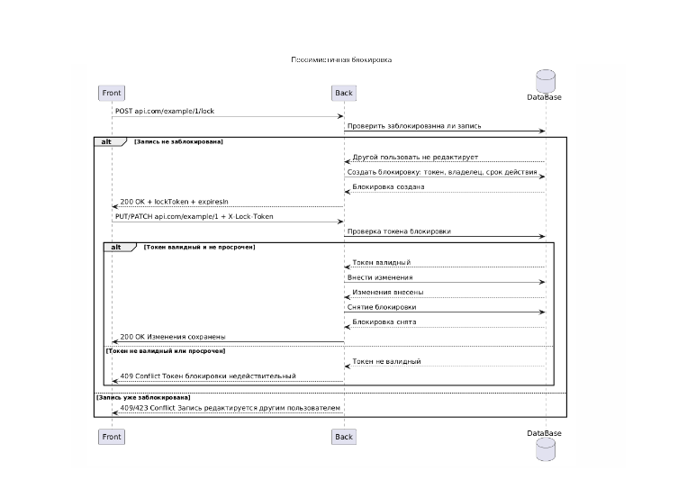

# Пессимистическая блокировка записи

Учебная UML-диаграмма последовательности для защиты записи от одновременного редактирования.

[Все примеры](../../README.md) · [Открыть изображение](pessimistic-lock.png)

## Сценарий

1. Клиент запрашивает блокировку записи.
2. Сервер проверяет наличие активной блокировки.
3. Если запись свободна, сервер сохраняет токен, владельца и срок действия блокировки и возвращает токен клиенту.
4. Клиент передаёт токен в заголовке `X-Lock-Token` при сохранении изменений.
5. Сервер проверяет токен, вносит изменения и снимает блокировку.
6. Для занятой записи, недействительного или просроченного токена предусмотрены ответы с конфликтом.

На рисунке используются условные адреса API и варианты HTTP-кодов 409/423. Это учебная модель взаимодействия, не описание реализованного механизма в опубликованных приложениях. Атомарность захвата блокировки и порядок проверки владельца необходимо определять при реализации.
