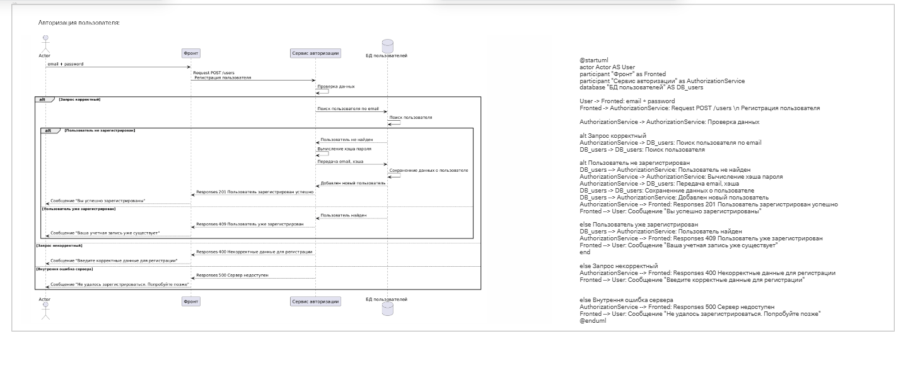
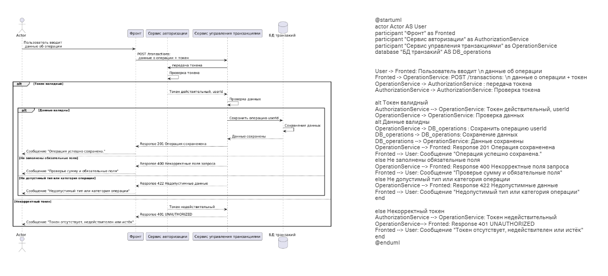

# Финансовый сервис

Проект учёта доходов и расходов для практического применения и личного изучения технологий. Я готовил требования, API-контракты и схемы взаимодействия, на основе которых создавалось приложение. В подборке представлены проектирование API, сценарии взаимодействия и правила обработки данных.

[Все примеры](../../README.md) · [Исходный проект](https://github.com/Olegmudr23/OpenVibeCoding)

## Материалы

| Материал | Назначение |
| --- | --- |
| [OpenAPI JSON](openapi.json) | Снимок контракта из проекта для базового режима авторизации |
| [Первоначальный YAML](drafts/original-contract.yaml) | Ранний незавершённый черновик, сохранён для истории; не является актуальным контрактом |
| [Регистрация пользователя](registration.png) | Учебная диаграмма последовательности |
| [Создание финансовой операции](create-transaction.png) | Учебная диаграмма последовательности с проверкой токена |
| [Документация Keycloak](https://github.com/Olegmudr23/OpenVibeCoding/blob/main/docs/keycloak.md) | Подключение авторизации и правила роли analyst |

## Архитектура

Клиент React и TypeScript обращается к API на NestJS. Финансовые операции сохраняются в SQLite. Реализация поддерживает два режима авторизации: Basic Auth и Keycloak.

В режиме Keycloak API проверяет подпись access token через JWKS, issuer, audience, сроки действия и тип токена. Пользователь определяется по `sub`, а не по переданному в теле запроса владельцу.

## API финансовых операций

| Метод | Путь | Поведение |
| --- | --- | --- |
| POST | `/transactions` | Создать операцию; вернуть её идентификатор |
| GET | `/transactions` | Получить доступные операции с фильтрами |
| GET | `/transactions/{transactionId}` | Получить детали операции |
| PATCH | `/transactions/{transactionId}` | Изменить категорию и/или описание |
| DELETE | `/transactions/{transactionId}` | Удалить операцию; ответ 204 |
| GET | `/health` | Проверить доступность сервиса и базы |

В контракте списка и создания путь записан как `/transactions/`; контроллер поддерживает запросы с завершающим слешем и без него.

## Правила данных и доступа

- Сумма новой операции строго больше нуля. В базе сумма хранится в копейках, в API используется `amount`.
- Внешнее поле даты — `transactionDate`; дата нормализуется в UTC.
- Владелец новой операции назначается сервером по аутентифицированному пользователю.
- Изменение ограничено категорией и описанием; сумма, дата, тип и владелец не редактируются.
- В режиме Keycloak обычный пользователь читает только свои операции. Роль `analyst` может читать все операции, но изменять и удалять — только собственные.
- Basic Auth использует локальную регистрацию `/auth/register` и получение профиля `/auth/me`. В режиме Keycloak локальная регистрация отключена.

## Регистрация пользователя

На диаграмме показаны проверка входных данных, поиск email, хеширование пароля и ответы 201, 400, 409 и 500. Подпись «Авторизация» на исходном изображении относится к сценарию регистрации: это ранний учебный материал.

## Создание операции

Показаны проверка токена, получение userId, проверка данных, сохранение операции и ответы 201, 400, 401 и 422.

## Версии документации

Схемы, исходный YAML и реализация отражают разные этапы проекта. В старом `docs/design.md` регистрация и JWT указаны как будущие функции; более поздние `src/app.ts`, `src/auth.ts` и документация Keycloak описывают уже добавленные режимы. Снимок `openapi.json` описывает Basic Auth; в режиме Keycloak приложение меняет схему авторизации Swagger на Bearer и исключает локальную регистрацию.

Обзор подготовлен по исходникам и документации на 25 ноября 2026 года. Запуск приложения и повторное выполнение его тестов в рамках подготовки подборки не проводились.
